 

[LinkedIn](https://www.linkedin.com/in/sri-kanth-g/) &nbsp;|&nbsp; [X](https://x.com/Srikanth97318) &nbsp;|&nbsp; [Repositories](https://github.com/srikanth97318?tab=repositories)

## About

I build **AI agents, RAG pipelines and LLM applications**, then dig into the engineering underneath until I can explain every layer.

| | |
| --- | --- |
| **Working on** | Multi-agent workflows, retrieval and grounding, secure AI systems |
| **Learning** | LLM evaluation, distributed systems, databases |
| **Soundtrack** | Michael Jackson on repeat |
| **Watching** | Scissor Seven |

## Best work

| | |
| --- | --- |
| **[Incident Commander](https://github.com/srikanth97318/Incident_Commander)** Multi-agent incident management for DevOps: security checks, triage, diagnosis, MCP-based investigation, human approval, auto-generated docs. `Python` `AI Agents` `MCP` `Gemini` | **[NexusMatch Engine](https://github.com/srikanth97318/NexusMatchEngine)** Talent matching and ranking: async ingestion, hybrid dense + sparse retrieval, LightGBM LambdaMART, SHAP explainability, fact-validated LLM reranking. `FastAPI` `Qdrant` `PostgreSQL` `LightGBM` |
| **[SecureFix AI System](https://github.com/srikanth97318/SecureFix-AI-System)** AI-assisted security fixing with a human in the loop. My most recent project. `Python` `Security` `LLMs` | **[aeigol-journal](https://github.com/srikanth97318/aeigol-journal)** Zero-trust AI journaling app: private multi-turn reflection, cryptographic authentication, tenant isolation. `Security` `AI` `Zero-trust` |

More experiments, from a Git-style VCS built from scratch to ARP packet handling, are in my [repositories](https://github.com/srikanth97318?tab=repositories).

## LeetCode

## Contributions

<picture>
  <source media="(prefers-color-scheme: dark)" srcset="https://raw.githubusercontent.com/srikanth97318/srikanth97318/output/github-snake-dark.svg">
  <source media="(prefers-color-scheme: light)" srcset="https://raw.githubusercontent.com/srikanth97318/srikanth97318/output/github-snake.svg">
  
</picture>

## Toolbox

`Python` `FastAPI` `LangChain` `Hugging Face` `MCP` `Qdrant` `LightGBM` `PostgreSQL` `Streamlit` `Docker` `Linux` `Git`
