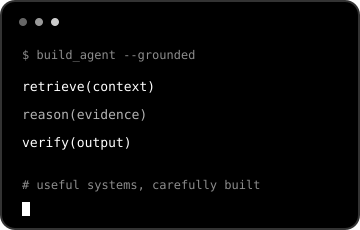

<h1>Hi, I'm Sri Kanth G</h1>
<h3>AI Engineer · Agents, RAG and secure AI</h3>

## About

- I build AI agents, RAG pipelines and LLM applications, and dig into the engineering underneath until I can explain every layer.
- **Currently building:** Multi-agent workflows, retrieval and grounding, secure AI systems
- **Currently learning:** LLM evaluation, distributed systems, databases
- **Outside of code:** RDJ MJ Prabhas on repeat; watching Scissor Seven & JJK & Black cover & Solo leveling

 

## Languages and tools

- **Languages:** [Python](https://www.python.org/) · [C++](https://isocpp.org/) · [SQL](https://www.w3schools.com/sql/)
- **AI/ML:** [PyTorch](https://pytorch.org/) · [TensorFlow](https://www.tensorflow.org/) · [JAX](https://jax.readthedocs.io/) · [scikit-learn](https://scikit-learn.org/) · [LightGBM](https://lightgbm.readthedocs.io/)
- **LLMs and retrieval:** [Hugging Face Transformers](https://huggingface.co/) · [LangChain](https://www.langchain.com/) · [LangGraph](https://www.langchain.com/langgraph) · RAG · MCP · [Qdrant](https://qdrant.tech/) · vector databases
- **Data and backend:** [PostgreSQL](https://www.postgresql.org/) · [FastAPI](https://fastapi.tiangolo.com/) · [Apache Spark](https://spark.apache.org/)
- **Cloud and MLOps:** [Docker](https://www.docker.com/) · [Kubernetes](https://kubernetes.io/) · [AWS](https://aws.amazon.com/) · [GCP](https://cloud.google.com/) · [Azure](https://azure.microsoft.com/)
- **Research and scientific computing:** [NumPy](https://numpy.org/) · [SciPy](https://scipy.org/) · [NVIDIA CUDA](https://developer.nvidia.com/cuda-toolkit) · [MPI](https://www.open-mpi.org/) · [Jupyter](https://jupyter.org/) · [Weights & Biases](https://wandb.ai/) · [MLflow](https://mlflow.org/)
- **Quantum platforms and technologies:** [Qiskit](https://www.ibm.com/quantum/qiskit) · [Cirq](https://quantumai.google/cirq) · [PennyLane](https://pennylane.ai/) · [Amazon Braket](https://aws.amazon.com/braket/) · [CUDA-Q](https://developer.nvidia.com/cuda-q) · VQE · QAOA · quantum circuits
- **Engineering tools:** [Git](https://git-scm.com/) · [Linux](https://www.kernel.org/) · automated testing

## Selected projects

- **[Incident Commander](https://github.com/srikanth97318/Incident_Commander)** — Multi-agent incident management for DevOps: security checks, triage, diagnosis, MCP-based investigation, human approval and auto-generated docs. 
  `Python` `AI Agents` `MCP` `Gemini`
- **[Medical RAG SYSTEM](https://github.com/srikanth97318/medical-rag)** — Retrieval-Augmented Generation system for medical document processing and QA With SELF correcting Engine framwork . 
 `Jupyter Notebook` `AI` ` Healthcare`
- **[NexusMatch Engine](https://github.com/srikanth97318/NexusMatchEngine)** — Talent matching and ranking with async ingestion, hybrid dense and sparse retrieval, LightGBM LambdaMART, SHAP explainability and fact-validated LLM reranking. 
  `FastAPI` `Qdrant` `PostgreSQL` `LightGBM`
- **[SecureFix AI System](https://github.com/srikanth97318/SecureFix-AI-System)** — AI-assisted security fixing with a human in the loop. 
  `Python` `Security` `LLMs`
- **[STAI COMPUTER VISION AI OPEN SOURCE](https://github.com/srikanth97318/STAI-COMPUTER-VISION-AI-OPEN-SOURCE)** — ALocal CCTV analysis tool using YOLO ONNX on CPU with optional Google Gemma vision review and Telegram incident alerts. 
  `Python` `Computer Vision` `Security`
- **[aeigol-journal](https://github.com/srikanth97318/aeigol-journal)** — Zero-trust AI journaling with private multi-turn reflection, cryptographic authentication and tenant isolation. 
  `Security` `AI` `Zero-trust`
- **[PEEVEDl](https://github.com/srikanth97318/Predicting-Eruptive-Events-at-Volcanoes-from-Earthquake-Data)** — Machine learning model for predicting volcanic eruptions using seismic earthquake data. 
  `Jupyter Notebook` ` Machine Learning` `Geophysict` 

More experiments, from a Git-style VCS built from scratch to ARP packet handling, are in my [repositories](https://github.com/srikanth97318?tab=repositories).

## LeetCode

## GitHub stats

