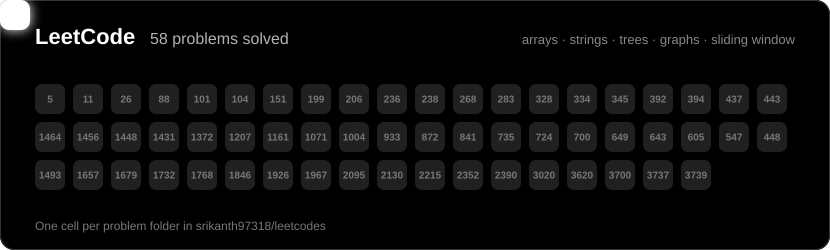

<h1>Hi, I'm Sri Kanth G</h1>
<h3>AI Engineer · Agents, RAG and secure AI</h3>
<a href="mailto:srikanth97318@gmail.com">Gmail</a> | <a href="mailto:PES2UG24AM161@stu.pes.edu">PES Email</a> | <a href="https://www.linkedin.com/in/sri-kanth-g/">LinkedIn</a> | <a href="https://www.instagram.com/srikanth.the.great/">Instagram</a> | <a href="https://x.com/Srikanth97318">X</a> | <a href="https://github.com/srikanth97318?tab=repositories">Repositories</a>

## About

- I build AI agents, RAG pipelines and LLM applications, and dig into the engineering underneath until I can explain every layer.
- **Currently building:** Multi-agent workflows, retrieval and grounding, secure AI systems
- **Currently learning:** LLM evaluation, distributed systems, databases
- **Outside of code:** Michael Jackson on repeat; watching Scissor Seven

 

## Languages and tools

`Python` `FastAPI` `LangChain` `Hugging Face` `MCP` `Qdrant` `LightGBM` `PostgreSQL` `Streamlit` `Docker` `Linux` `Git`

## Selected projects

- **[Incident Commander](https://github.com/srikanth97318/Incident_Commander)** — Multi-agent incident management for DevOps: security checks, triage, diagnosis, MCP-based investigation, human approval and auto-generated docs. 
  `Python` `AI Agents` `MCP` `Gemini`
- **[NexusMatch Engine](https://github.com/srikanth97318/NexusMatchEngine)** — Talent matching and ranking with async ingestion, hybrid dense and sparse retrieval, LightGBM LambdaMART, SHAP explainability and fact-validated LLM reranking. 
  `FastAPI` `Qdrant` `PostgreSQL` `LightGBM`
- **[SecureFix AI System](https://github.com/srikanth97318/SecureFix-AI-System)** — AI-assisted security fixing with a human in the loop. 
  `Python` `Security` `LLMs`
- **[aeigol-journal](https://github.com/srikanth97318/aeigol-journal)** — Zero-trust AI journaling with private multi-turn reflection, cryptographic authentication and tenant isolation. 
  `Security` `AI` `Zero-trust`

More experiments, from a Git-style VCS built from scratch to ARP packet handling, are in my [repositories](https://github.com/srikanth97318?tab=repositories).

## LeetCode

## GitHub stats

